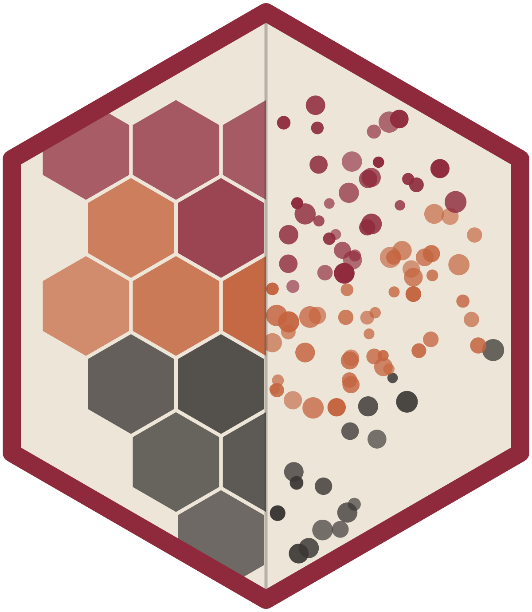

# plotomics

<!-- badges: start -->
[](https://lifecycle.r-lib.org/articles/stages.html#stable)
[](https://www.npmjs.com/package/plotomics)
[](https://doi.org/10.5281/zenodo.21926306)
[](https://github.com/samuelbharti/plotomics/blob/main/LICENSE)
<!-- badges: end -->



Headless, framework-agnostic bioinformatics visualization components. Each
component is a factory: `createX(element, { data, options })` returns an
instance with `setData` / `setOptions` / `resize` / `destroy` (and `exportSVG` /
`exportPNG` where supported). The same factories power the R (htmlwidgets) and
Python (anywidget) wrappers, so a figure looks and behaves the same in all three
languages.

## Install

```sh
npm install plotomics
```

The same name on every registry: `npm install plotomics`,
`pip install plotomics`, `install.packages("plotomics")`.

## Subpath imports

Import each component from its own subpath. The bundle then holds that
component and its engine, and the build needs only the peers of that
component (see [Optional engine peer dependencies](#optional-engine-peer-dependencies)):

```js
import { createEmbedding } from "plotomics/embedding";

// 3,000 cells in three clusters.
const centres = { "T cell": [0, 0], "B cell": [4, 1], NK: [2, 4] };
const x = [];
const y = [];
const color = [];
for (const [type, [cx, cy]] of Object.entries(centres)) {
  for (let i = 0; i < 1000; i += 1) {
    x.push(cx + Math.random() + Math.random() - 1);
    y.push(cy + Math.random() + Math.random() - 1);
    color.push(type);
  }
}

// An element on the page, such as <div id="plot"></div>.
const el = document.getElementById("plot");
const inst = createEmbedding(el, {
  data: { columns: { x, y, color } },
  options: {
    pointSize: 4,
    mouseMode: "lasso",
    onSelect: (idx) => console.log(`${idx.length} cells selected`),
  },
});
```

The barrel import (`import { createVolcano } from "plotomics"`) loads every
component, so the bundler must resolve all eight optional peers, also the
ones of components you never use. The package sets `"sideEffects": false`,
which lets a bundler drop the unused code, but only after it has resolved
those imports. Without the peers the build stops: esbuild cannot resolve
`gosling.js`, `react`, `react-dom/client`, `igv/dist/igv.esm.js`,
`graphology`, `graphology-layout-forceatlas2`, `sigma` and `sigma/rendering`,
and Vite reports exports missing from them. Use the barrel only when all the
peers are installed.

## Browser and bundler

The components draw into the page, so they need a browser (or another DOM),
and the package ships ES modules for a bundler such as Vite or esbuild. Six
entries cannot be imported in plain Node, so a server-side render cannot
import them either:

| Import | Fails in plain Node through |
| --- | --- |
| `plotomics/volcano`, `plotomics/embedding` | `regl-scatterplot` |
| `plotomics/gosling` | `higlass-text`, which `gosling.js` loads |
| `plotomics/igv` | `igv` |
| `plotomics/network` | `sigma` |
| `plotomics` (the barrel) | all of the above |

In an app that renders on the server, import these components only in code
that runs in the browser, for example with `await import("plotomics/volcano")`
inside an effect.

## Sizing

A plot fills the padding box of its element, inside any border, so give
the element a CSS height. An element with no height of its own gets a
content height of 480 px, so the plot does not cover the content below it.
This covers an element added to the page after the plot is drawn too, also
inside a shadow root. The
480 px comes from a CSS rule in a cascade layer of its own with the lowest
priority, so any height your CSS sets wins over it, in a layer or not,
also one set later. `destroy()` removes it again.

The R and Python wrappers resize their plots when the page changes size. In
plain JavaScript, `autoResize` passes each new size of the element to the
plot. It also gives the 480 px to an element that was hidden when the plot
was made, such as one in a tab, if it has no height once shown. A plot drawn
before its element is in the page keeps the size it was first drawn at until
`autoResize` or a `resize()` call runs. Call the function `autoResize`
returns before `destroy()`; an observer still running after `destroy()`
gives the empty element the 480 px again:

```js
import { createVolcano } from "plotomics/volcano";
import { autoResize } from "plotomics/core";

const plot = createVolcano(el, { data: { columns: { x, y } } });
const stop = autoResize(el, plot);

// When the plot is removed:
stop();
plot.destroy();
```

## The shared core

`plotomics/core` exposes the pieces every component is built on: the component
contract (`PlotomicsFactory`, `PlotomicsInstance`), theming (`defaultTheme`,
`darkTheme`, `OKABE_ITO`, `PALETTE_20`), colour ramps and palettes (`viridis`,
`rdbu`, `ltc`, `ltcdiv`, `categoricalColors`, `categoricalScale`), the binary
column transport (`decodeColumns`), the export helpers (`serializeSVG`,
`canvasToPNG`, and `compositePNG`, which draws the canvases and the SVG
overlay into one PNG) and the sizing helpers (`measure`, `autoResize`).

```js
import { defaultTheme, categoricalScale } from "plotomics/core";
```

Import it directly if you are building a component that should speak the same
contract, or just to reuse the colour scales.

## Optional engine peer dependencies

The heavy rendering engines are declared as **optional `peerDependencies`**, so
`npm install plotomics` does not drag all of them in. Fourteen of the seventeen
components render on `regl`, the canvas 2-D context, or `d3`, all bundled as
regular dependencies, so nothing extra is needed. Three do need an engine
alongside them:

| Import | Install alongside |
| --- | --- |
| `/volcano`, `/embedding`, `/heatmap`, `/clustermap`, `/hic`, `/treemap`, `/dotplot`, `/violin`, `/spatial`, `/oncoplot`, `/lollipop`, `/km`, `/profile`, `/upset` | *(nothing extra)* |
| `plotomics/gosling` | `gosling.js pixi.js react react-dom` |
| `plotomics/igv` | `igv` |
| `plotomics/network` | `sigma graphology graphology-layout-forceatlas2` |

If you import a component without its engine, your bundler reports the missing
module at build time. Install only the engine(s) your app actually uses:

```sh
# e.g. an app that uses the network graph
npm install plotomics sigma graphology graphology-layout-forceatlas2
```

`react` and `react-dom` are optional peers required only by `plotomics/gosling`:
Gosling.js is a React component, and the Gosling component mounts it with
React. No other plotomics component uses React. Gosling.js 1.0.7 supports
React 16 through 18 and pixi.js 6, which is why those peer ranges stop short
of the current majors.

### React 19

npm checks an optional peer whenever the project has that package. In a
project on React 19, `npm install plotomics` therefore stops with an
`ERESOLVE` error, even when the project never imports `plotomics/gosling`.
Until Gosling.js supports React 19
([#72](https://github.com/samuelbharti/plotomics/issues/72)), add an override
to the `package.json` of the project. It gives plotomics the React of the
project and keeps the peer check for every other package:

```json
"overrides": {
  "plotomics": {
    "react": "$react",
    "react-dom": "$react-dom"
  }
}
```

The other way is `--legacy-peer-deps`, which turns the peer check off for
every package. It holds for one install only: a later plain `npm install`
stops with `ERESOLVE` again. Pass it on every install, or set it once in the
`.npmrc` of the project:

```sh
npm install plotomics --legacy-peer-deps
# or, for every install:
echo "legacy-peer-deps=true" >> .npmrc
```

Every component except `plotomics/gosling` then works with React 19.
`plotomics/gosling` still needs React 18.

## Documentation

- [Reference](https://www.samuelbharti.com/plotomics/js/) for every factory,
  options type and core helper
- [Project overview](https://www.samuelbharti.com/plotomics/): every component,
  and the R and Python packages

Types ship with the package, so an editor gives the full API inline.

## License

MIT. See [LICENSE](https://github.com/samuelbharti/plotomics/blob/main/LICENSE).

## Acknowledgements

Barret Schloerke and Carson Sievert advise this work as thesis advisors.
Posit Software, PBC funded early work on this package and holds copyright
together with the author.
